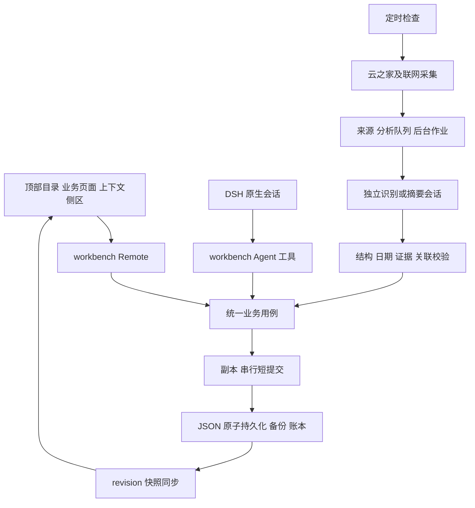

# 智能工作台架构与功能

更新：2026-10-28。版本：0.2.0 工作树候选版，基于 `8c32b56` 演进，尚未提交。实现与验证证据见 [实施记录](IMPLEMENTATION-STATUS-0.2.0.md)，验收状态见 [待办](TODO-AI-AUTOMATION.md)。

目标是收到消息后清楚知道需要答复什么、处理什么，并能沿来源追溯。页面、原生会话助手和后台任务共用 Host 业务用例；模型的描述不替代落库结果。

## 1 当前分层

- **Host**：`src/host/{domain,storage,application,analysis,assistant,automation,integrations,news,workflows,api,search,platform}`，持有业务数据、连接器、原生会话适配、队列与持久化。
- **Client**：`src/client/{features,components,shell,assistant,core}`，管理页面、表单草稿、导航及助手，不自行访问企业凭据。
- **共享契约**：`src/shared/contracts.ts` 定义 Source、Task、Reply、分析输出等；模型输入仍做运行时校验。`news.ts` 提供可解释的主题/项目匹配排序。
- **入口与构建**：`src/host.ts`、`src/client.ts` 使用标准模块导入；esbuild 保持 Host ESM 与 Client `window.__ModuleLoader__.load` 工厂契约，React 由宿主注入。
- **类型边界**：全项目启用严格检查，新增公共组件及共享契约有明确类型；部分既有宿主动态对象和兼容页面仍使用显式 `any`，并不代表外部 JSON 已可信。

目前注册 78 个 Remote 端点和 16 个 Agent 工具。单个 Host 负责一份业务状态；当前没有独立服务器或跨机器同步服务。

模块文件名使用职责命名，不依赖数字排序。旧路径与新路径见 [映射表](MODULE-PATH-MAP.json)，新增流程、开发入口和最新实测见 [模块重构记录](MODULAR-REFACTOR-AND-OFFICE-UPGRADE-2026-10-28.md)。

## 2 信息架构与组件

| 顶部入口 | 已编码的能力 |
| --- | --- |
| 今日简报 | 紧凑统计、同步详情、待回复与待办摘要、资讯及快捷动作 |
| 任务中心 | 列表/看板、筛选、来源、统一事件表单和执行记录 |
| 待回复 | 全量浏览、检索、阶段维护、来源依据、关联任务及完整 AI 识别队列 |
| 资讯 | 主题/项目匹配排序、时效、检索、原文与摘要、收藏及转任务 |
| 知识空间 | 笔记、收藏、片段的维护与检索 |
| 更多 | 统一搜索、Agent 中心、16 项离线工具、只读研发探测、连接设置 |

宿主侧栏中的工作台入口继续保留，插件不再占用第二条左栏。顶部使用宿主 `--dsh-frame-top-clearance` 避让窗口控件，普通浏览器回退为 0。已在桌面普通窗口、全屏、侧栏开关及明暗主题走查；窄容器在 1024px 及以下采用单页上下文模式。

`TopNavigation`、`StatsStrip`、`SyncStatus`、`CompactEmptyState`、`TaskEventFields`、`ContextFormPane`、`AnalysisQueuePanel`、`WorkflowJobs` 和 `MigrationImportPanel` 是已拆出的 TSX 组件。任务编辑与助手在同一侧区切换；窄容器隐藏正文并提供返回/关闭入口。切换目录可收起编辑，继续编辑恢复草稿。

## 3 数据实体

| 实体 | 职责 |
| --- | --- |
| Source | 原消息/资讯证据，保留摘录、时间、发送人、项目与定位；消息身份包含组织/账号、会话和消息 |
| Reply | 沟通义务，阶段为待回复、已确认收到、已回复、不需回复；保留人工保护、依据和 taskIds |
| Task | 实际处理义务，独立状态机、优先级、期限、项目、来源引用和人工保护 |
| AgentRun | 与任务关联的执行记录、步骤、证据；执行记录完成与任务完成不等同 |
| Radar / Knowledge | 资讯原文与四段摘要，以及收藏、笔记、代码片段 |
| AnalysisQueue | 每条来源的识别状态、结果、重试时间、租约与产出任务 |
| Jobs / Operations | 耗时指令的作业状态、输入和结果，以及幂等操作账本 |
| ChangeHistory / QualityReviews | 原子提交的变更前后快照及人工识别复核；支持冲突检查后撤销 |
| ReplyDrafts / ReminderSnoozes / AiUsage | 本地回复草稿、提醒延期和后台调用及 Token 计量 |
| SyncCursors | 每会话最新完成边界、历史续采锚点与会话发现页码 |

Task 状态保持 `draft / ready / running / waiting_approval / completed / failed / cancelled`。Reply 与 Task 平行，一条消息可产生一个 Reply 和多个 Task；两者分别完成。

事件字段包含 `eventType / deliverable / meetingStart / meetingEnd / meetingLocation / registrationTarget`。未知字段留空；缺失会议时长不推测。旧 Task 回复字段在 schema 升级时转为独立 Reply，保留原 Task ID 和已有来源关联。

## 4 消息与理解流程

1. `yzj-cli whoami` 获取真实身份，`orgId + openId` 区分账号上下文；`im group recent` 发现会话。
2. 私聊 `groupType=1` 的他人消息与群内 @本人可作为新事项入口；系统/助手会话不作为普通交办。
3. 分页保存新消息与上下文；命中游标的页面仍保留新半页。超限/失败保存续采位置，成功保存的消息和对应游标一起提交。
4. 每批会话发现与历史读取有边界；后续 tick 继续补采。识别等待对应会话补采完成，并按原消息时间处理。
5. 同组织/账号、会话和项目组装有限上下文，提示包括双方发言、准确回复引用及已有对象 ID。
6. 模型只返回结构化结果；Host 校验类型、日期、原文依据、关联范围和义务。一条消息可拆事项，无义务不建档。
7. 确认收到保留答复义务；本人实质答复或交付证据只推进对应记录。人工改动、忽略和处理确认受保护。

历史补采默认超过14天先进入待复核，不自动创建当前Task/Reply，也不逐条消耗模型；可在队列逐条识别，再显式确认。窗口可设置7/14/30/90天。遇到云之家10000429立即冷却两分钟，持久化尚未读取的会话并续采，避免继续请求其他会话。

标题包含关系不再作为跨会话合并依据。询问完成时间不会直接写为承诺期限；“明天/后天”的输出日期按原消息时间及中国时区核对。

真实 CLI 已验证最近会话和消息字段可读；真实桌面模型已用合成双向消息验证语义与写回。完整企业历史、跨账号切换及读取对原应用未读状态的影响仍单独观察。

## 5 聊天与后台

助手复用 DSH 原生 Session，Client 自绘历史、工具结果、上下文和输入区。工作台数据由 DSH_HOME 决定，原生聊天由 Session ID 决定，切换会话不切换数据空间。

识别、摘要分别使用后台会话，并从人工助手列表中排除。宿主工具 guard 阻止后台会话直接执行工具，业务变更统一在结构校验后提交。消息识别按云之家账号持久复用会话，取消固定六轮轮换；同账号多消息一次模型调用，业务关联仍按原聊天和项目隔离。首批发送协议，后续发送新消息、变化上下文及权威事项快照；Host逐条校验批次、来源和临时事项引用。会话忙则排队，冷启动继续原ID，真实丢失才重建；压缩后补发规则。识别支持 onlyIds 逐条处理和完成历史重放，详见[批量与会话设计](MESSAGE-BATCH-AND-SESSION-REUSE-2026-10-28.md)。

短指令通过业务工具直接执行；耗时识别/摘要可以立即返回 jobId，记录 queued/running/completed/failed 和结果。队列在进程内排空，失败有限退避重试；原生模型超时或出错不当成成功。

定时器每分钟检查采集是否到期、是否仍有续采或待处理工作。完整采集间隔与后台排空分开；一轮按采集→分析→摘要执行，未完成分析不会阻塞普通待办操作。退出/休眠期间不执行，重启或热重载时立即恢复中断租约；休眠恢复通过心跳识别运行暂停，中断条目和作业回排，不消耗业务重试次数。补采不重复搜索资讯或重置完整采集时钟。

持久化提交队列与缓存按状态文件路径跨模块代际共享；每次挂载有独立所有权标识，旧异步事务在等待前后检查身份，旧清理回调不能停止新挂载。后台会话仍在运行时，本批等待原会话，不创建替代会话。

模型服务故障与业务识别失败分开：错误轮次、认证和指定网络故障停止当前批次，保留业务条目；分别对识别/摘要持久化5分钟、10分钟退避，连续三次后停止自动调用。首页显示原因，现有运行入口可显式解除阻断；耗时作业在退避期间保持排队，不能假报完成。

AI、自动登记、定时采集各自可配置。新安装默认关闭；自动登记只控制新 Task，Reply 仍按识别结果建立。后台依赖目标宿主模型认证、会话服务和网络能力。

## 6 资讯

无 RSS 时使用宿主 `web.search` 按主题发现，查询带最近时间范围；每轮最多三个主题并轮换，AI Agent/RAG 查询明确语义。已知过旧或未来发布日期不作为新资讯进入，明确的历史日期路径只用于排除旧文。未知日期明确标注，不能用抓取时间冒充发布。

原文由宿主抓取，HTTP 错误或内容不足分别报告；提取时去除导航噪声，保留文末及可用性限制。摘要使用独立会话，按技术变化、应用、风险和实践写回；缺段可补齐，原文未涉及的段落明确说明，已有非空内容优先保留。失败记录次数、原因与下次重试时间。

URL 与标题相似度用于发现去重；资讯页面使用确定性的主题/项目名称匹配排序，同等相关时优先较新内容。此排序是可解释匹配，不是模型置信度或完整语义推荐。

## 7 持久化与迁移

默认路径：`~/.dsh/storages/dev-workbench/state.json`，可由 DSH_HOME 改变。文件 schema v2，revision 是独立递增的业务修订号。

提交过程：读取当前状态副本→校验/修改→原子落盘→发布新缓存。串行队列隔离并发变更；抛错和落盘失败不会污染已发布状态。网络和模型等待位于提交锁之外。

迁移格式 v2 包含 projects、tasks、sources、runs、knowledge、radar、candidates、replies、analysisQueue、operations、jobs 、changeHistory、qualityReviews 及 syncCursors、replyDrafts、reminderSnoozes。默认排除机器设置、凭据及 DSH 原生会话。旧格式支持兼容导入，未包含的旧集合明确提示并保留当前数据。

预检是纯操作，验证校验和、版本、数量、重复 ID 和关联；提交前重新校验并成功备份，然后 await 原子提交。后台模型仍在运行时拒绝实际导入。合并保留同 ID 当前记录；替换只作用于包内业务集合。界面展示数量、冲突和项目目录映射，修改映射后重新预检。

读取损坏文件时保留原件，备份恢复前先成功备份当前数据。跨机器不会自动恢复原生会话或凭据；会话及机器路径需要分别处理。

新增业务记录可恢复归档，并提供服务端分页查询；常用列表每页 30 条。数据文件仍是单个 JSON，归档不会物理缩小文件；当前没有 SQLite、多进程事务或跨设备同步。

## 8 验证与剩余门槛

严格类型检查、构建产物一致性、Host、可靠性、十页渲染和真实 React 交互均有本轮运行记录。隔离 DSH headless profile 已安装并加载当前插件，产生 schema v2 空状态。

后续桌面连接已恢复，复用已有 GLM-5.3-Flash 实际跑通聊天工具、十条合成消息的语义闭环、联网资讯与摘要、GUI 合并预检和重启。此前独立 headless 默认路由的 MISSING_CREDENTIAL 不再作为桌面模型阻挡。主要闭环通过不代表所有自然语言或长期运行均已覆盖；后续休眠、未读对照与长时间观察见 [可靠性记录](RELIABILITY-VALIDATION-2026-10-28.md)，其中区分修复前异常、修复后窗口及未覆盖矩阵。

详见 [实施与验证记录](IMPLEMENTATION-STATUS-0.2.0.md)、[待办](TODO-AI-AUTOMATION.md) 与 [业务验收手册](REAL-VALIDATION-RUNBOOK.md)。

## Agent办公执行升级

新增批量回复草稿、日报/周报、待办处理方案三类持久作业，复用已有模型，支持步骤产物、依据、取消与继续；原消息识别/资讯摘要作业也显示真实进度。详情和验证边界见[实现记录](AGENT-WORKFLOWS-IMPLEMENTATION-2026-10-28.md)。

## 知识自动检索整改

聊天两条路径和回复/待办方案接入同一知识检索层，提供片段、版本、来源定位和范围过滤；默认本地全文检索，可按明确配置启用向量融合。实现及验证边界见[知识检索实施记录](KNOWLEDGE-RETRIEVAL-IMPLEMENTATION-2026-10-28.md)。
